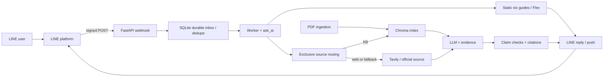

# FINAL Presentation Context — WAD26-03

**Course:** EN813701 Web Application Development 2026

**Project:** AI Line Chatbot for Agricultural Drone Knowledge Base

**Repository inspection:** 1 November 2026. This file is a presentation-preparation document, not a deployment or an acceptance certificate.

## Evidence labels and reading rules

- **VERIFIED:** directly supported by the cited current source, a saved test artifact, or a dated validation result. A saved result verifies only what happened in that run.
- **INFERRED:** a reasonable interpretation of project goals, architecture, or demo suitability; not a measured result.
- **NOT FOUND:** no supporting evidence located in the inspected repository. This does not prove the event never happened.
- Request/response examples below are **sanitized illustrations**, unless explicitly marked as a recorded result. Placeholder values are not real user IDs, credentials, deployed hosts, provider responses, or prices. SDKs may add headers and fields. No environment-variable values are reproduced here.
- The repository has substantial uncommitted changes; current working-tree code can differ from the latest Git commit. Historical reports and current code must not be conflated.

## 1. Project overview

**Problem and users — INFERRED, grounded in requirements.** Thai-speaking agricultural drone pilots and operators need practical answers about operating and maintaining drones, spraying, herbicides, investment, and aviation registration. Relevant information is spread across Thai PDFs, slides, tables and official websites; an ordinary generated answer may be hard to trace back to a source or may mix conditions, rates, or units. The project aims to make these materials easier to query in LINE. Sources: [project requirements](docs/PROJECT_REQUIREMENTS.md), [README](README.md), PDFs in [data](data/).

**Objectives — VERIFIED as stated requirements:** answer relevant questions in Thai, retrieve suitable document or web evidence, give useful answers with filename/page or the actual source URL, preserve quantities/units/conditions, and acknowledge missing evidence or service failures. Sources: [PROJECT_REQUIREMENTS.md](docs/PROJECT_REQUIREMENTS.md), [natural answer prompt](app/rag/prompts/natural_answer.txt), [evidence.py](app/rag/evidence.py).

**Implemented behavior — VERIFIED in code, with validation limits:**

1. LINE webhook receives text, follow, and recognized postback events; validates the LINE signature and persists jobs before acknowledging. A SQLite inbox/worker deduplicates redelivered events. [webhook.py](app/api/webhook.py) `webhook`; [line_inbox.py](app/services/line_inbox.py).
2. Six rich-menu guides are prewritten, and a Flex menu can be returned for the menu/follow flow. These are static fast-path answers, not generated anew. [rich_menu_service.py](app/services/rich_menu_service.py) `RICH_MENU_ITEMS`, `get_rich_menu_preanswer`, `menu_card`; [line_service.py](app/services/line_service.py) `_messages`; [menu answers](data/rich_menu_answers/).
3. Ordinary new questions go through a custom Python RAG pipeline: classify/route, retrieve document evidence or web evidence, generate an answer, check certain claims and render citations. Each question is processed independently; SQLite stores LINE events, not previous answers by question. [ai_service.py](app/services/ai_service.py) `ask_ai`; [exclusive_pipeline.py](app/rag/exclusive_pipeline.py) `run_exclusive_pipeline`; [natural_answer.py](app/rag/natural_answer.py) `render`.
4. KB retrieval combines a persistent Chroma vector collection and BM25/lexical retrieval with reranking/page selection. PDF ingestion can extract native text/tables and selectively use vision. [vector_store.py](app/rag/vector_store.py); [slide_retriever.py](app/rag/slide_retriever.py); [ingestion pipeline](app/ingestion/pipeline.py).
5. A separate local browser playground supports simulated and live modes. Simulation is canned and explicitly labelled; opening it does not call the model. [playground.py](app/playground.py); [app.js](app/playground_assets/app.js); [scripts/playground.py](scripts/playground.py).

**Incomplete / limited — VERIFIED:**

- The default LINE pipeline chooses KB or web for a response and rejects some mixed requests; it does **not** automatically merge KB and web evidence into one answer. A separate support pipeline is experimental and is not the default LINE entry point. [exclusive_pipeline.py](app/rag/exclusive_pipeline.py); [ARCHITECTURE.md](docs/ARCHITECTURE.md).
- Each question is independent; follow-up conversation context is not maintained in the default path. [README.md](README.md); [ai_service.py](app/services/ai_service.py).
- Latest saved live answer attempt after the fixes stopped at the first question with a provider error classified by the app as quota exhaustion. Two planned questions did not run. The evaluation deliberately pinned one model and disabled fallback; the ordinary configured fallback was not tested by that run. [final live review](cache/eval/final_try_network_20261101/review.md).
- LINE validation checked message format and webhook status, not receipt on a phone, the accuracy of all six guides, or full end-to-end messaging after the changes. [line validation](cache/eval/final_try_network_20261101/line.json); [review](cache/eval/final_try_network_20261101/review.md).
- The answer validator is a set of heuristics, not a complete semantic proof. The formulation-conflict check only catches the implemented patterns and cannot guarantee that all conflicting source facts are detected. [release-fixes review](cache/eval/release_fixes_20261101/review.md); `line_problem`, `_remove_conflicting_formulated_rates` in [natural_answer.py](app/rag/natural_answer.py).
- **NOT FOUND:** verified current public production host, stable public deployment URL, documented live user adoption metrics, a complete human-verified accuracy rate across all topics, or an after-fix phone-delivery recording. A previous API observation of an active HTTPS webhook does not establish who hosts it or that delivery works. [README](README.md); [current state](docs/CURRENT_STATE.md).

## 2. Technology stack and architecture

| Layer | What is present | Evidence / qualification |
|---|---|---|
| User interface | LINE Official Account interface: rich menu, Flex and text; separate HTML/CSS/JavaScript playground | [LINE service](app/services/line_service.py), [assets](app/playground_assets/). The playground is local, not the LINE app. |
| Backend | Python, FastAPI, Uvicorn; LINE Messaging SDK | [requirements.txt](requirements.txt), [app/main.py](app/main.py), [webhook.py](app/api/webhook.py). |
| RAG and AI | Custom Python retrieval/routing/validation; OpenAI-compatible SDK for configured chat gateway; Google Gen AI SDK for embeddings and optional vision; Tavily SDK for web | [rag_service.py](app/rag/rag_service.py), [embedding.py](app/rag/embedding.py), [web_fallback.py](app/rag/web_fallback.py). **Do not claim LangChain powers the primary LINE pipeline**: the active path is custom Python. |
| Storage | Persistent Chroma knowledge index; SQLite durable LINE inbox; source PDFs and cache files | [vector_store.py](app/rag/vector_store.py), [line_inbox.py](app/services/line_inbox.py), [compose.yaml](compose.yaml). SQLite is not the removed repeated-question answer cache. |
| Deployment | Dockerfile, Docker Compose, local Uvicorn; public hosting requires additional setup | [Dockerfile](Dockerfile), [compose.yaml](compose.yaml), [DEPLOYMENT.md](docs/DEPLOYMENT.md). Docker build/smoke in older records is historical, not a current production proof. |
| PDF / images | PyMuPDF, pypdf, Pillow; ingestion and optional Google vision | [requirements.txt](requirements.txt), [ingestion](app/ingestion/). |
| Tests | pytest, FastAPI TestClient, mocks and offline replay | [tests](tests/), [TEST_PLAN.md](docs/TEST_PLAN.md). |

**Data flow — VERIFIED in source:**



The playground is a separate FastAPI app: browser `fetch` → local `/api/ask` → demo fixture or `ask_ai` in live mode. It does not start a LINE inbox worker. The diagram does not imply KB and web are combined within one answer. [app/playground.py](app/playground.py), [app.js](app/playground_assets/app.js).

## 3. External APIs actually called by code

These are outbound integrations. Python packages/SDKs are client libraries, not separate APIs. Routes in section 4 are the team's inbound APIs. Exact model selection and gateway base can be configured; an SDK's public default endpoint below is not proof of the current runtime configuration. No private URLs or environment values are included.

### 3.1 KKU Gen AI — OpenAI-compatible chat completion

**VERIFIED code:** [app/config.py](app/config.py) declares public default base `https://gen.ai.kku.ac.th/api/v1`; [rag_service.py](app/rag/rag_service.py) `get_llm_client`, `call_llm` uses the OpenAI-compatible `chat.completions.create`. Normal SDK path: **POST** `https://gen.ai.kku.ac.th/api/v1/chat/completions` when that declared base is used. An optional secondary OpenAI-compatible base/client is configurable, but its actual configured URL/status is **NOT FOUND** here and is not disclosed.

**Purpose:** compose a Thai answer from the question and retrieved evidence. **Input:** model identifier, system/user messages, temperature, output limit; options vary by mode. **Output:** choices containing message content and finish reason; usage may be available. **Errors:** classified quota/auth/rate-limit/timeout/provider errors, bounded attempts/cooldowns and optional configured fallback; incomplete responses are not accepted as final. See `call_llm` and [service_status.py](app/service_status.py).

Illustrative request and response, not a recorded transaction:

```json
{"model":"<MODEL>","messages":[{"role":"system","content":"Answer only from supplied evidence."},{"role":"user","content":"<QUESTION_AND_EVIDENCE>"}],"temperature":0,"max_tokens":1000}
```

```json
{"choices":[{"message":{"role":"assistant","content":"<answer with source markers>"},"finish_reason":"stop"}],"usage":{"total_tokens":1234}}
```

The last saved pinned live attempt instead ended in quota-classified unavailability, so this success example must not be shown as that run's real output. [recorded run](cache/eval/final_try_network_20261101/review.md).

### 3.2 Google Gen AI — embeddings and optional vision

**Embedding — VERIFIED code and installed SDK path:** [embedding.py](app/rag/embedding.py) `embed_text`, `embed_texts`, `_embed_request` calls `client.models.embed_content`. The installed SDK's non-Vertex default is **POST** `https://generativelanguage.googleapis.com/v1beta/models/{model}:batchEmbedContents`; `{model}` is selected by code. The app validates nonempty vectors and matching batch size, retries selected transient errors, and can fall back to individual inputs after a batch shape error. Purpose: represent text for semantic similarity in Chroma. The 1 November live attempt recorded one embedding call, but that does not establish answer generation success.

Illustrative SDK-level input/output, not a wire capture:

```json
{"model":"<EMBEDDING_MODEL>","contents":["<question or document text>"]}
```

```json
{"embeddings":[{"values":[0.12,-0.03,0.08]}]}
```

The vector is abbreviated; its length and numbers are illustrative. Code: [embedding.py](app/rag/embedding.py), [vector_store.py](app/rag/vector_store.py).

**Vision / PDF reader — optional, not proof of active use:** [vision_extractor.py](app/ingestion/vision_extractor.py) `generate_with_retry` and [direct_pdf.py](app/rag/direct_pdf.py) `read_pdf_pages` call `client.models.generate_content`; installed Google SDK default path is **POST** `https://generativelanguage.googleapis.com/v1beta/models/{model}:generateContent`. Inputs are prompt plus image/PDF content and generation settings; output is generated text/structured transcription, subject to validation/errors. Illustrative input: `{"contents":[{"parts":[{"text":"<transcribe page>"},{"inlineData":{"mimeType":"application/pdf","data":"<BASE64>"}}]}]}`; illustrative output: `{"candidates":[{"content":{"parts":[{"text":"<transcription>"}]}}]}`. Do not present this optional path as a call made in the latest run.

### 3.3 Tavily — web search and extraction

**VERIFIED code + installed SDK defaults:** [web_fallback.py](app/rag/web_fallback.py) `get_tavily_client`, `search_web_fallback` call **POST** `https://api.tavily.com/search` and **POST** `https://api.tavily.com/extract`. The optional alternate planner is in [web_retrieval.py](app/rag/web_retrieval.py). The app passes a query, depth and result limits; CAAT requests can use designated URLs and restrict search domains. Returned result text, title and page URL become web evidence. Timeout/failures are recorded; missing results are not treated as a verified answer.

Illustrative search:

```json
{"query":"<agricultural drone question>","search_depth":"basic","max_results":3}
```

```json
{"results":[{"title":"<source title>","url":"https://example.org/article","content":"<retrieved excerpt>"}]}
```

Illustrative extract: request `{"urls":["https://example.org/article"],"extract_depth":"basic"}`; response `{"results":[{"url":"https://example.org/article","raw_content":"<page text>"}],"failed_results":[]}`. The domain is a placeholder, not a source used by this project. Latest bounded run stopped before web search; prior results are historical. [latest review](cache/eval/final_try_network_20261101/review.md).

### 3.4 LINE Messaging API — runtime and administrative calls

**VERIFIED code and installed LINE SDK defaults:**

| Outbound call | Method / public endpoint | Code / purpose |
|---|---|---|
| Reply | POST `https://api.line.me/v2/bot/message/reply` | [line_service.py](app/services/line_service.py) `send_reply`; reply token + text/Flex messages → LINE delivery request. |
| Push fallback | POST `https://api.line.me/v2/bot/message/push` | `send_push`; target + messages and optional retry key → fallback when appropriate. |
| Loading animation | POST `https://api.line.me/v2/bot/chat/loading/start` | `show_loading_animation`; optional chat ID and duration. |
| Create rich menu | POST `https://api.line.me/v2/bot/richmenu` | [rich_menu_service.py](app/services/rich_menu_service.py) `setup_rich_menu`; returns a menu ID. **Administrative mutation**, not part of normal answer generation. |
| Upload menu image | POST `https://api-data.line.me/v2/bot/richmenu/{richMenuId}/content` | `setup_rich_menu`; binary image. |
| Set default menu | POST `https://api.line.me/v2/bot/user/all/richmenu/{richMenuId}` | `setup_rich_menu`; administrative mutation. |

Illustrative reply request: `{"replyToken":"<REDACTED>","messages":[{"type":"text","text":"<answer>"}]}`; illustrative success is HTTP 200 with an empty JSON object. Illustrative push: `{"to":"<REDACTED>","messages":[{"type":"text","text":"<answer>"}]}`. A Flex request uses `type: flex`, `altText`, and a Flex container. `classify_send_error` distinguishes invalid reply token, permanent/retryable/unknown delivery; push retry keys help avoid duplicate deliveries. [line_service.py](app/services/line_service.py); [line_inbox.py](app/services/line_inbox.py).

The project’s [audit script](scratch/final_try_network_20261101.py) additionally calls read/validation endpoints: GET `/v2/bot/user/all/richmenu`, GET `/v2/bot/richmenu/{id}`, POST `/v2/bot/richmenu/validate`, POST `/v2/bot/message/validate/reply`, GET `/v2/bot/channel/webhook/endpoint`, all at `https://api.line.me`. The saved run reports 11 HTTP 200 results and no sends/settings changes. This is **validation evidence**, not a production user message. [line.json](cache/eval/final_try_network_20261101/line.json).

### 3.5 Bangchak public price endpoints — special-case structured source

**VERIFIED in code, not tested in the latest live run:** [official_fuel.py](app/rag/official_fuel.py) `read_prices`, `parse_prices`, `render_prices`; routing in [exclusive_pipeline.py](app/rag/exclusive_pipeline.py). It reads **GET** `https://oil-price.bangchak.co.th/BcpOilPrice1/th` (HTML widget) and **GET** `https://oil-price.bangchak.co.th/apioilprice2/th` (JSON feed). Inputs are the user's fuel question, plus local date/deadline; outputs include the displayed date, relevant price items and applicability text. The parser checks date, price format, duplicate grades and source scope; invalid, stale or unavailable data is not silently accepted. Illustrative feed response shape: `{"OilDateNow":"<DATE>","OilList":[{"OilName":"<GRADE>","PriceToday":"<PRICE>"}],"OilRemark":"<SCOPE>","OilRemark2":"<EFFECTIVE>"}`. Do not present sample prices as current prices. Routing does not imply that live access or coverage of all fuel stations was proven.

## 4. APIs developed by the team

The project defines two separate applications, so identical paths do not mean the same service. No verified public base URL is included. `127.0.0.1` addresses below are local examples only.

### 4.1 Production-style LINE app: `app.main:app`

| Method / path | Implementation and input | Authentication / access | Response and client evidence |
|---|---|---|---|
| GET `/` | [main.py](app/main.py) `root`; no body | No app-level auth. Network reachability depends on deployment. | `{"message":"Agriculture Drone Chatbot API is running!"}`. **NOT FOUND:** project browser client using it; operational root. |
| POST `/webhook` | [webhook.py](app/api/webhook.py) `webhook`; LINE event envelope and required `X-Line-Signature` header | Signature checked against LINE channel secret; missing header → 422; invalid signature → 400; unavailable inbox → 503. Public access requires a configured HTTPS ingress; current public host **NOT FOUND**. | `{"status":"OK"}` after accepted events are persisted. Client is the external LINE platform, not a project `fetch`; code imports `WebhookParser`, tests send signed requests, and LINE's webhook-active check is recorded. Actual post-change phone-to-reply flow not verified. |
| POST `/api/webhook` | Same router/function, mounted again under `/api` in [main.py](app/main.py) | Same as `/webhook` | Same response. [test_line_integration_contract.py](tests/test_line_integration_contract.py) posts to alias; this is a test HTTP client, not proof of a deployed LINE client. |
| GET `/health/live` | [health.py](app/api/health.py) `live` | No app-level auth; network-dependent | `{"status":"alive"}`. Docker health tooling/operator may call health routes; no project UI uses this app's route. |
| GET `/health/ready` | [health.py](app/api/health.py) `ready`, `local_checks` | No app-level auth; network-dependent | Example: `{"status":"ready","checks":{"knowledge_index":true,"inbox":true,"worker":true},"external_providers":"not_probed"}`; 503 when checks fail. Dockerfile health check requests it over HTTP. It does **not** verify provider quota. |

Illustrative webhook body, identifiers and signature are placeholders, never real user data:

```json
{"destination":"<BOT_ID>","events":[{"type":"message","message":{"type":"text","id":"<MESSAGE_ID>","text":"ก่อนบินต้องตรวจอะไร"},"timestamp":0,"source":{"type":"user","userId":"<USER_ID>"},"replyToken":"<REDACTED>","webhookEventId":"<EVENT_ID>","deliveryContext":{"isRedelivery":false},"mode":"active"}]}
```

The webhook's response acknowledges receipt; it is **not** the final chat answer. The inbox worker later invokes the LINE outbound API. [webhook.py](app/api/webhook.py); [line_service.py](app/services/line_service.py).

### 4.2 Local playground app: `app.playground:app`

| Method / path | Input, implementation and auth | Example response / evidence of HTTP client |
|---|---|---|
| GET `/` | [playground.py](app/playground.py) `home`; serves HTML; no login | Returns HTML, not JSON. Local browser navigation. |
| GET `/health/live` | `health`; no login | `{"status":"alive","application":"playground","line_worker":false,"provider_probed":false,"pipeline":"baseline"}`. [app.js](app/playground_assets/app.js) calls `fetch("/health/live")`. |
| POST `/api/ask` | `ask`, `Question`, `live_response`; JSON `question` 1–2,000 characters, `mode` demo/live, `scenario` mixed/kb/web/unverified/quota, `source` auto/kb/web. Demo defaults are defined in the model. | Example request: `{"question":"ก่อนบินต้องตรวจอะไร","mode":"demo","scenario":"kb","source":"auto"}`. Example response: `{"answer":"<simulated KB answer>","elapsed_ms":1.2,"mode":"demo","pipeline":"baseline","status":"ok","error_code":null,"notice":"ข้อมูลจำลองสำหรับลองหน้าจอ ไม่ใช่คำแนะนำหรือหลักฐานจาก KB/web จริง และไม่ได้เรียก AI"}`. [app.js](app/playground_assets/app.js) sends `fetch` with JSON. Timing and answer placeholder are illustrative. |

The playground accepts local trusted hosts and same-origin JSON for non-GET requests; it has no user login and is **not intended as a public API**. It returns 403 on wrong origin, 415 for non-JSON, 422 for invalid input, 409 when a live call is already running, and 503 for service unavailability. In the baseline path, `source` does not force a source selection; it is passed to the experimental support path. [playground.py](app/playground.py) `local_browser_only`, `ask_live`, `live_response`.

`/assets` is a static mount. FastAPI may supply autogenerated schema/docs routes for the LINE app; these are framework-provided, not team-authored business APIs. Playground docs/OpenAPI are disabled. Do not claim the local `/api/ask` is deployed publicly or that the LINE app implements it. [main.py](app/main.py); [playground.py](app/playground.py).

## 5. Feature demo: 2–3 minutes

**Before presenting:** prepare a local machine with dependencies, existing KB and working credentials managed privately; restart the correct process after changes. Start the local playground as described in [README.md](README.md). Confirm quota and connectivity yourself shortly before the talk. No secrets, LINE IDs, private webhook URL, or personal chats should appear in screenshots.

| Time | Presenter action | Expected observation / evidence |
|---|---|---|
| 0:00–0:25 | State the pilot problem; show the six-area rich menu image or a sanitized phone screenshot if available. | Menu asset [rich_menu_bg.png](assets/rich_menu/rich_menu_bg.png). If showing only the asset, say it is a design image, not proof a phone received it. |
| 0:25–0:55 | Show local playground, select **demo** and KB scenario, enter a short question. | Label the answer as **simulated**: it comes from `DEMO_ANSWERS`, not the PDF or model. Show `POST /api/ask` in DevTools if useful. |
| 0:55–1:35 | If service works, select **live**, ask `ก่อนบินโดรนต้องตรวจอะไรบ้าง`. | Aim for inspection items with PDF filename/page; compare to [ฟีเจอร์โดรนของฉัน.pdf](data/ฟีเจอร์โดรนของฉัน.pdf), page 1. Output is not guaranteed; latest recorded pinned attempt returned quota unavailable. |
| 1:35–2:05 | If web service and quota work, ask `ตามคู่มือ CAAT ถ้าสอบ E-Exam ไม่ผ่าน ต้องรอกี่ชั่วโมงจึงสอบใหม่ และจำกัดจำนวนครั้งหรือไม่` | Expected reference from prior reviewed case: 24 hours, no limit, with the actual official document URL and stated scope. Verify the current source and the live output; this case was **not run** in the latest attempt. [cases.json](cache/eval/delivery_audit_20261101/cases.json). |
| 2:05–2:30 | Show one actual LINE guide or Flex message if a test device and active service are available; otherwise show sanitized payload/test artifact. | API validation is proven; actual phone delivery and appearance after changes remain to be demonstrated. |
| 2:30–3:00 | Explain KB vs web routing, citations, and an honest limitation. | Show architecture diagram and the quota/unsupported/mixed behavior; do not claim automated KB+web merging. |

**Fallback if live fails:** deliberately show the labelled demo mode and the saved [LINE validation summary](cache/eval/final_try_network_20261101/review.md), then explain the last live quota failure. A saved historical answer can illustrate the output format only if labelled with its date and that it predates the latest fix. Never claim a simulated screenshot is a real AI response.

**Screens to capture:** local playground in demo mode with notice visible; a real live response and exact citation only if obtained; source PDF page; official web page; six-button LINE rich menu and Flex on a test phone if available; sanitized LINE validation statuses; the FastAPI request/response in browser DevTools; architecture slide. **NOT FOUND:** a verified post-change phone screenshot/video and a publicly deployable project URL.

## 6. Testing, recorded results and evidence

| Evidence | Actual recorded outcome | What it does / does not prove |
|---|---|---|
| [release fixes](cache/eval/release_fixes_20261101/review.md) | Focused offline run: **131 passed, 8 subtests passed, 1 dependency warning** | Code behavior in selected tests; not all tests, not answer accuracy or production readiness. |
| [saved u03 replay](cache/eval/release_fixes_20261101/offline_replay.json) | Prior raw answer + saved evidence replayed after fix; both mixture component rates shown; synthetic wrong term/page cases rejected | Verifies this replay and controls, not fresh generation from the current model. |
| [latest live test](cache/eval/final_try_network_20261101/review.md) | 1 of 3 cases attempted; provider error classified as quota exhaustion; two not run | No post-fix answer-quality score. Recorded token figure was a reservation, not confirmed consumption. |
| [LINE validation](cache/eval/final_try_network_20261101/line.json) | 11 HTTP 200 API reads/validations; six menu messages + Flex valid; active webhook | Payload structure and state at that time; no actual message delivery or truth check. |
| [earlier answer audit](cache/eval/delivery_audit_20261101/review.md) | Earlier pinned model: KB results 2/3 complete, web 1/2 complete, mixed refusal 1/1 under that audit's scope | Historical small sample, different code/config and not a system-wide accuracy percentage. |

**Validation and error handling — VERIFIED:** signature rejection and durable webhook persistence; per-line cited numbers/labels/table checks; page and URL citation metadata; explicit unavailability/abstention; timeout/cooldown and limited fallback handling; local playground same-origin checks. These measures reduce certain risks and do not prove all semantic claims. Tests include [test_release_grounding_regressions.py](tests/test_release_grounding_regressions.py), [test_natural_mixture_context.py](tests/test_natural_mixture_context.py), [test_line_integration_contract.py](tests/test_line_integration_contract.py), [test_playground.py](tests/test_playground.py).

**Known problems / fixes:** the previous renderer dropped a correct separate mixture component; replay is now fixed with negative controls. Uncited-page model names and unsupported English chemical names were accepted in specific test cases; checks tightened. Prefix/hyphen tests and a document ID routing problem were fixed. Some source documents provide conflicting rate units; the narrow implemented safeguard can detect a particular answer format only. The latest live provider quota stopped assessment. [release-fixes review](cache/eval/release_fixes_20261101/review.md).

**Adoption and feedback — NOT FOUND:** an independently verified number of real users, usage analytics, external pilot survey, interview transcript, or demonstrable post-change phone session. Owner-authored requirements and review notes are design feedback, not proof of external adoption. [PROJECT_REQUIREMENTS.md](docs/PROJECT_REQUIREMENTS.md), [tests/data/source_gold_2026-10-18_review.csv](tests/data/source_gold_2026-10-18_review.csv).

## 7. Development and AI usage

- **VERIFIED:** Git history is present; `git rev-list --count HEAD` returned **51** at inspection. Recent commit subjects include the LINE Flex menu and deployment changes. The working tree has many changes beyond the latest commit; do not present the history as a complete account of current work. Verify group responsibilities with the team; no personal names or identities are included in this report.
- **VERIFIED:** AI-assisted development is documented in [AGENTS.md](AGENTS.md), [CLAUDE.md](CLAUDE.md), [ANTIGRAVITY_HANDOFF.md](docs/ANTIGRAVITY_HANDOFF.md), and [LEARNING_LOG.md](docs/LEARNING_LOG.md). These establish documented tool-assisted work, not exact percentages of AI-authored code or proof of each team member's contribution.
- **VERIFIED:** deployed answer instructions and prompt variants exist in [natural_answer.txt](app/rag/prompts/natural_answer.txt), [grounded_answer.txt](app/rag/prompts/grounded_answer.txt), and [grounded_answer_concise.txt](app/rag/prompts/grounded_answer_concise.txt). The natural prompt instructs the model to answer from supplied sources, retain conditions/units and use source markers. Present a short excerpt or paraphrase, and distinguish the **application prompt** from prompts used to develop code.
- **VERIFIED:** [evaluate_answers.py](scripts/evaluate_answers.py) contains an optional judge prompt, but the latest run used no judge. Do not describe the rule-based production validator as an LLM judge.
- **Problems and solutions:** document tables can lose row relationships; extraction, page evidence and table-aware checks preserve some relationships. The old verifier discarded a correct mixture component; a saved replay and negative regressions check the fix. Provider quotas motivated bounded calls, error messages and configurable fallbacks. LINE redelivery motivated a persistent event inbox. Sources: [table_grounding.py](app/rag/table_grounding.py), [line_inbox.py](app/services/line_inbox.py), [service_status.py](app/service_status.py), [release-fixes review](cache/eval/release_fixes_20261101/review.md).

## 8. Suggested 10-minute presentation

| Time | Slide | What to say / show |
|---|---|---|
| 0:00–0:45 | Title and problem | Project name, agricultural drone operator scenario, information spread across sources. |
| 0:45–1:30 | Users and objectives | Thai LINE interface, practical answer with traceable evidence and appropriate uncertainty. |
| 1:30–2:30 | Architecture | Diagram above; identify LINE webhook, SQLite event queue, KB/web routing, generation, validator, citations. |
| 2:30–3:30 | Technology stack | FastAPI/Python, Chroma + BM25, Google embedding SDK, KKU-compatible chat gateway, Tavily, LINE SDK, Docker; distinguish libraries vs APIs. |
| 3:30–4:30 | APIs | One inbound webhook snippet and one local `/api/ask` fetch; one outbound LINE reply or chat completion call. Show request/response examples with placeholders. |
| 4:30–7:00 | Demo | Use the 2–3 minute script; label demo fixtures; present saved quota outcome if live unavailable. |
| 7:00–8:00 | Testing | 131 focused offline passes; u03 replay; 11 LINE validation successes. State what each does not prove. |
| 8:00–9:00 | Challenges and fixes | Tables/units/incorrect citations; durable queue and quota failures; limited semantic checking. |
| 9:00–10:00 | Limitations and next steps | Actual phone delivery, live KB/web accuracy after fixes, provider availability, broader document/menu verification, hosting. |

**Good code snippets for slides:** `webhook()` signature verification and `inbox.store.add_events` in [webhook.py](app/api/webhook.py); `fetch("/api/ask", ...)` in [app.js](app/playground_assets/app.js); `client.chat.completions.create(...)` in [rag_service.py](app/rag/rag_service.py); `send_reply()` in [line_service.py](app/services/line_service.py); optionally the citation logic in [natural_answer.py](app/rag/natural_answer.py). Crop out all real identifiers and configuration values.

**Still to collect:** post-change phone recording and menu/Flex screenshots; successful current live KB and web answers with the corresponding source pages; sanitized network request/response screenshot; current deployment/hosting proof if claiming a hosted service; team-confirmed contribution allocation and any consented user feedback; a documented evaluation set and human-reviewed results if claiming an accuracy rate.

**Unsupported claims to avoid:** “100% accurate”, “zero hallucinations”, “all 3 final questions passed”, “all 131 tests prove the AI is accurate”, “live LINE end-to-end passed”, “LINE validation sent a message”, “KB and web are always merged”, “the playground is a public production API”, “LangChain is the main LINE framework”, “has production hosting/users”, “fallback worked after quota”, or “current price is X” without new evidence. Do not put credentials, personal information, private endpoints, webhook URLs, or runtime environment-variable values on slides.
