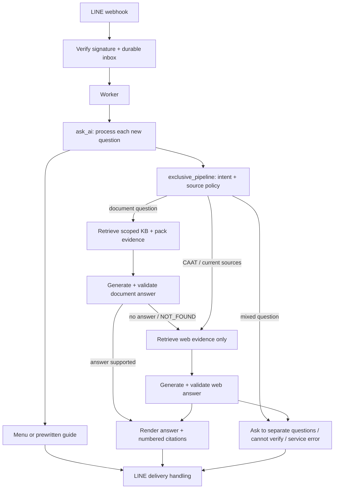

# โครงสร้างที่มีอยู่

เส้นทาง LINE ตรวจจากโค้ด 2026-11-01 ไม่ใช่ข้อบังคับให้รักษาเทคโนโลยีเดิม
ข้อกำหนดอยู่ที่ [PROJECT_REQUIREMENTS](PROJECT_REQUIREMENTS.md) สถานะอยู่ที่ [CURRENT_STATE](CURRENT_STATE.md)

## ทาง support สำหรับทดลอง (ไม่ใช่ค่าเริ่มต้น LINE)

`support_pipeline` ใช้retrievalเดิม แล้วแยกข้อความกับtyped table catalog (`structured_tables`)
เมื่อเลือกtable chunk ให้ใช้corpusที่ค้นอยู่แล้วหาข้อความ nativeจากหน้า/ส่วน/ไฟล์และsource SHAเดียวกัน
แล้วส่งเป็นsourceแยกพร้อมหน้า ไม่เดาเงื่อนไขใส่เซลล์และไม่แก้ฐานข้อมูล
คำถามข้อความ/ขั้นตอนส่งsourceเดิมรวมแถวตารางและเลขลำดับทุกหน้าให้โมเดล1ครั้ง ตอบclaims/quotesที่ชี้แถวจริง
sourceในpayloadมีเลขบรรทัด; โมเดลส่งsource ID+เลขบรรทัด แล้วbackendดึงquoteจริงมาตรวจ คำตอบที่ไม่ยืนยันช่วงงอกที่ถามต้องแสดงเป็นpartial
รับJSONหรือrespond XML envelopeที่ครบและจำกัดโครงสร้างเป็นข้อมูลเท่านั้น ห้ามเรียกtoolและห้ามกู้ข้อความที่ถูกตัด
เฉพาะคำถามคำนวณ/จัดอันดับตัวเลขส่งข้อความกับschema แล้วรับJSON query plan
`table_query` ตรวจtable/column/filter/unit/limitและสร้างparameterized SQLite queryเอง เรียงตัวเลขด้วยDecimal
แล้วrenderค่าจากแถวเดิมพร้อมเงื่อนไข/หน้าอ้างอิง ไม่มีการให้โมเดลเขียนคำตอบตารางรอบที่สอง
ทางคำนวณไม่ให้โมเดลจัดอันดับจากfree text ตารางไม่ครบ/สกัดไม่ครบห้ามอ้างglobal min/max/rank
ทางข้อความรักษาแถว/หน่วย/เงื่อนไขและpage provenance ไม่ผูกการอ่านขั้นตอนกับparserหรือqueryตารางเดียว
supportและweb plannerปิดfallbackจริงด้วยallow_fallback=False ไม่ใช่อาศัยmax_attemptsอย่างเดียว
CAATในsupportอ่านdesignatedเอกสารจริง ไม่ใช้search summaryแทนหลักฐาน
Catalogเป็นread modelจากretrieved evidenceต่อคำถาม ส่งออกSQLiteได้ ไม่แก้หรือre-ingestKBต้นทาง
การตรวจplanว่าเข้าใจคำถามครบเป็นคนละเรื่องกับการตรวจtype/unit/SQLและต้องประเมินแยกกัน
ทางนี้ยังไม่ใช่entrypoint LINEด้านล่าง ดูสถานะการวัด/การส่งที่CURRENT_STATE

## ทาง LINE ปัจจุบัน

`ai_service.ask_ai` เรียก `exclusive_pipeline.run_exclusive_pipeline` ใช้ `natural_answer` เมื่อ `ANSWER_MODE=natural` หรือ `evaluate_evidence()` ในโหมด grounded ไม่รวมหลักฐาน KB+เว็บในคำตอบเดียว
Rich menu ทั้ง 6 หัวข้อคืนไฟล์ข้อความโดยตรง ส่วนข้อความขอเมนู/follow event คืน Flex ผ่าน `line_service._messages` จึงต้องตรวจเนื้อหาคำตอบสำเร็จรูปแยกจาก RAG
ตั้งแต่ 1 พ.ย. ไม่มีแคชคำตอบและไม่แชร์ generation ระหว่างคำถามที่ข้อความเหมือนกัน ทุกข้อความใหม่เข้าสู่ pipeline ใหม่ ส่วน SQLite inbox ป้องกันเฉพาะ webhook event เดิมถูกส่งซ้ำและเก็บงานรอส่ง ไม่ใช้ค้นคำตอบให้คำถามใหม่ตามข้อความ
โมเดลหลักในค่าตั้งใช้งานคือ `gemini-3.7-flash` ผ่าน KKU; fallback ยังเป็นไปตาม config เดิม URL อ้างอิงมาจากหน้าเว็บใน evidence โดยคง path/query/fragment ถึง LINE ไม่แถม homepage ในหมายเหตุ CAAT
มี model fallback ตาม config และอาจมี generation สองรอบเมื่อ KB ไม่พบแล้วไปเว็บ จึงต้องแยกเวลาค้น/ตอบและสถานะบริการ
Validation ช่วยตรวจข้อผิดพลาดบางประเภท ไม่ใช่หลักฐานว่าความหมายถูกต้องทุกกรณี

| ส่วนงาน | ตำแหน่งหลัก |
| --- | --- |
| Startup / lifecycle | `app/main.py` |
| Local playground แยกจาก LINE | `app/playground.py`, `app/playground_assets/`, `scripts/playground.py` |
| LINE และ health | `app/api/` |
| เรียก pipeline ต่อคำถามใหม่ / เมนูสำเร็จรูป | `app/services/ai_service.py` |
| RAG, partial KB+web และ source policy | `app/rag/` |
| PDF extraction / structured chunks | `app/ingestion/` |
| Ingestion และเครื่องมือดูหลักฐาน | `scripts/` |

ปัจจุบัน retrieval ใช้ Chroma dense + corpus BM25 และ page fusion/diversity ตาม config
แหล่งอ้างอิงมาจาก typed metadata ไม่เชื่อ source string ที่โมเดลแต่งเอง
provider/model เลือกผ่าน environment ห้ามถือว่าชื่อ provider ในรายงานเก่าเป็น config จริงของเครื่อง

Ingestion ปัจจุบัน: approved PDFs → layout/native text/tables + selective Vision → records/chunks พร้อม provenance → cached batch embeddings → publish index
ข้อมูล legacy บางส่วนยังมีอยู่ ห้ามอธิบายทั้งคลังว่าเป็น fixed window 800/120 หรือ v4 ทั้งหมด
ดู [INGESTION](INGESTION.md) สำหรับขอบเขตและหน้าที่ยัง incomplete

Local playground ใช้แอปแยก (`app.playground:app`) มี `POST /api/ask` และ static UI
เริ่มต้นโหมด demo ไม่ import RAG/config/provider; live ค่อยโหลด `ask_ai` เมื่อเจ้าของกดส่ง
ไม่ start LINE worker/inbox และไม่รวม endpoint นี้ในแอป production `app.main`
ตรวจ Host/Origin และเสิร์ฟเฉพาะ loopback ผ่าน launcher; ไม่ได้ออกแบบเป็นบริการ public
