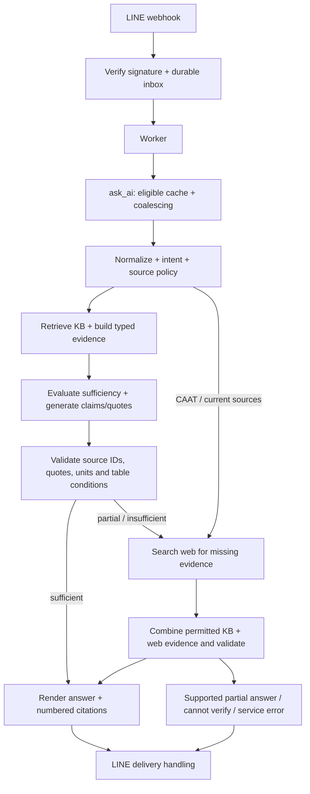

# โครงสร้างที่มีอยู่

อ้างโค้ดที่ตรวจในรอบก่อน 2026-10-17 ไม่ใช่ข้อบังคับให้รักษาเทคโนโลยีเดิม
ข้อกำหนดอยู่ที่ [PROJECT_REQUIREMENTS](PROJECT_REQUIREMENTS.md) สถานะอยู่ที่ [CURRENT_STATE](CURRENT_STATE.md)

การประเมิน sufficiency และสร้างคำตอบรวมอยู่ใน `evaluate_evidence()` ไม่ได้มี grader LLM แยกเป็นข้อบังคับ
มี repair/fallback ได้ จึงต้องระวังค่า latency จากการเรียกซ้ำ
Validation ช่วยตรวจข้อผิดพลาดบางประเภท ไม่ใช่หลักฐานว่าความหมายถูกต้องทุกกรณี

| ส่วนงาน | ตำแหน่งหลัก |
| --- | --- |
| Startup / lifecycle | `app/main.py` |
| Local playground แยกจาก LINE | `app/playground.py`, `app/playground_assets/`, `scripts/playground.py` |
| LINE และ health | `app/api/` |
| Orchestration / cache | `app/services/ai_service.py` |
| RAG, partial KB+web และ source policy | `app/rag/` |
| PDF extraction / structured chunks | `app/ingestion/` |
| Ingestion และเครื่องมือดูหลักฐาน | `scripts/` |

ปัจจุบัน retrieval ใช้ Chroma dense + corpus BM25 และ page fusion/diversity ตาม config
แหล่งอ้างอิงมาจาก typed metadata ไม่เชื่อ source string ที่โมเดลแต่งเอง
provider/model เลือกผ่าน environment ห้ามถือว่าชื่อ provider ในรายงานเก่าเป็น config จริงของเครื่อง

Ingestion ปัจจุบัน: approved PDFs → layout/native text/tables + selective Vision → records/chunks พร้อม provenance → cached batch embeddings → publish index
ข้อมูล legacy บางส่วนยังมีอยู่ ห้ามอธิบายทั้งคลังว่าเป็น fixed window 800/120 หรือ v4 ทั้งหมด
ดู [INGESTION](INGESTION.md) สำหรับขอบเขตและหน้าที่ยัง incomplete

Local playground ใช้แอปแยก (`app.playground:app`) มี `POST /api/ask` และ static UI
เริ่มต้นโหมด demo ไม่ import RAG/config/provider; live ค่อยโหลด `ask_ai` เมื่อเจ้าของกดส่ง
ไม่ start LINE worker/inbox และไม่รวม endpoint นี้ในแอป production `app.main`
ตรวจ Host/Origin และเสิร์ฟเฉพาะ loopback ผ่าน launcher; ไม่ได้ออกแบบเป็นบริการ public
