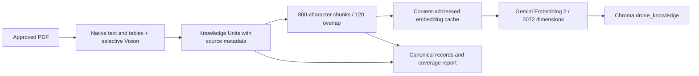
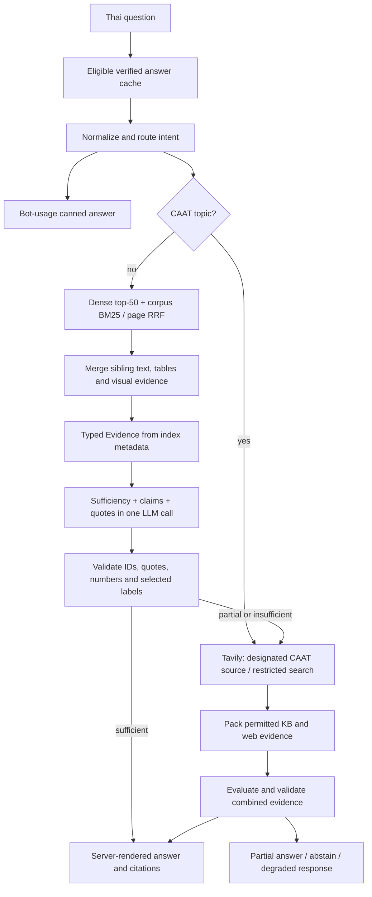

> Historical snapshot before the 2026-10-17 MD overhaul. Not current instructions or status. Relative Markdown links rebased for this location.

# Architecture — verified code path, 2026-10-16

> Current text ingestion (2026-10-17) uses `scripts.ingest` → layout/native tables + selective
> Vision → structured row/paragraph chunks → batched cached embeddings → safe publication.
> See [INGESTION.md](../../../INGESTION.md) and [delivery status](../../../RELEASE_READINESS_2026-10-17.md).
> Existing legacy UAV chunks are retained; the fixed-window ingestion diagram below
> describes that earlier path. Default retrieval is now text + global/diverse.

See [the requirements audit](../../../PROJECT_AUDIT_2026-10-16.md) for gaps. This describes
implementation, not production readiness or a zero-hallucination guarantee.

## Offline ingestion (default text mode)

- `scripts/ingest_pdf.py` checks page ranges, fingerprints the source and handles pages independently.
- Vision is cached by PDF hash/model/cache version, with bounded retries/timeouts.
- Failed/degraded/empty pages are reported; incomplete CLI/batch runs exit nonzero.
- Reports and Knowledge Unit/chunk records go to `cache/ingestion/` or `--report` paths.
- Embeddings are cached under `CHROMA_PATH/embedding_cache/` by content/model/dimensions.
- Upsert precedes stale-ID deletion. This protects against rejected upserts; it is not
  a transaction spanning both operations or a full KB generation switch.
- Existing records do not acquire new provenance retroactively.

## Online query path

There is no speculative parallel grader/generator. `evaluate_evidence()` combines
sufficiency and generation; `parse_grounded_result()` validates the result.
Validation does not prove semantic correctness across multiple table rows.

Default `global/none` uses corpus BM25 + dense RRF with the custom domain/crop/topic
reranker disabled. Legacy reranking remains an evaluation option. This differs from
literal R2; the audit records the mismatch rather than claiming full compliance.

The live path calls `retrieve_evidence()`. File/page references come directly from
index metadata, never delimiters inside untrusted PDF text. `retrieve_context()`
and the old string parser remain display/fixture helpers.

CRAG defaults to a 22-second request budget, including an 8-second KB-generation
sub-budget. Calls use remaining deadlines; provider timeouts are not hard wall-clock
guarantees. Stage timings are exposed to the evaluation tools.

## Experimental direct PDF mode

`PDF_RETRIEVAL_MODE=direct` uses `drone_pdf_pages_v1`. Each PDF page is embedded;
retrieved snapshots are transcribed into typed evidence at answer time, with a cache.
It has no BM25 and is not the default. See [DIRECT_PDF.md](../../../DIRECT_PDF.md).

## LINE transport

Current path: signature verification -> await thread-pool RAG -> Reply API -> HTTP 200.
The event loop is not blocked, but the webhook request waits for RAG. There is no
durable inbox or webhookEventId deduplication. Reply failure triggers push without
distinguishing unknown delivery outcomes. These remain audit findings; async ACK
and worker delivery have not been implemented.
